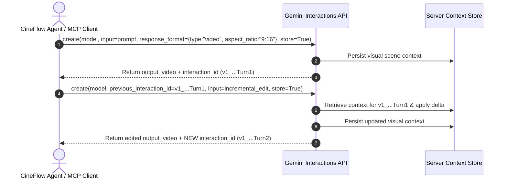

# واجهة التفاعلات الحفظية وخادم MCP لتوليد وتعديل الفيديو — Gemini Stateful Interactions API & FastMCP Video Agent (`references/gemini-interactions-api.md`)

يُوثّق هذا المرجع المعمارية الكاملة لواجهة **`Gemini Interactions API`** الحفظية (`Stateful Video Generation & Multi-Turn Conversational Editing`) لنموذج **`gemini-omni-1.2-flash`** (`Omni 1.2 Flash` — وللإصدار السابق `gemini-omni-1.1-flash`)، بالإضافة إلى خادم البروتوكول الموحد **`FastMCP` (`mcp/server.py` — `omni-video-agent`)** وأدواته الثماني للتوليد (`3–15s` بزيادة ثانية واحدة، `$0.07/s` عند `720p`) والتعديل الحواري المجاني (`0 credits` على Flow) ونقل الحركة (`Motion Transfer`) والتحريك والنشر على يوتيوب.

---

## 1. المعمارية الحفظية مقابل عديمة الحالة (`Stateful vs. Stateless Video Architecture`)

في نماذج الفيديو التقليدية عديمة الحالة (`Stateless`)، يتطلب أي تعديل إعادة كتابة البرومبت الكامل من الصفر مما يؤدي غالباً إلى ضياع ثبات الشخصية والإضاءة وحركة الكاميرا.
أما مع **`Interactions API`**:
1. **التوليد الأساسي (`Initial Generation`):** استدعاء `client.interactions.create(..., store=True)` يولّد الفيديو ويحفظ السياق البصري على خوادم Google ويُرجع معرّف تفاعل فريد **`interaction.id` (`v1_...`)**.
2. **التعديل التراكمي (`Stateful Multi-Turn Edit`):** في الجولة التالية، نمرر **`previous_interaction_id`** مع برومبت تعديل مختصر يصف **التغيير فقط** (مثل: `"Make it nighttime with heavy snowfall. Keep everything else the same."`) دون إعادة وصف المشهد.
3. **قانون تسلسل أحدث معرّف (`Latest Interaction ID Chaining Law`):**
   - كل عملية تعديل تُرجع **`interaction.id` جديداً** يشترك في البادئة السياقية مع الجولات السابقة وينتهي بذيل جديد يمثل الحالة المحدثة.
   - **إلزامي:** مرّر دائماً **أحدث `interaction.id`** للجولة التالية؛ لأن تمرير معرّف قديم (`Stale ID`) يُفرّع الجلسة بصمت من حالة سابقة ويلغي التعديلات اللاحقة.
4. **قانون وراثة أبعاد الفيديو (`Aspect Ratio Inheritance Law`):**
   - يُحدَّد `aspect_ratio` (`"16:9"` أو `"9:16"`) **عند التوليد الأولي فقط (`generate_video`)**.
   - التعديلات الحفظية (`edit_video`) ترث أبعاد الفيديو تلقائياً من `previous_interaction_id`، ولذلك **يُمنع تمرير `aspect_ratio` في `edit_video`**.

---

## 2. أنماط التسليم (`Delivery Modes`: `inline` vs. `uri` & The `4 MB` Ceiling)

يدعم `response_format` نمطين لاستلام ملف الفيديو الناتج:
1. **`inline` (الافتراضي للمقاطع الصغيرة `< 4 MB`):**
   - يعود الفيديو مضمّناً بصيغة `Base64` داخل `interaction.output_video.data`.
2. **`uri` (مُوصى به للمقاطع الطويلة أو عالية الحركة أو `>= 4 MB`):**
   - يُضبط عبر `response_format={"type": "video", "delivery": "uri"}`.
   - يُرفع الفيديو الناتج إلى **Google File API** ويعود الرابط في `interaction.output_video.uri`.
   - يستخرج الخادم معرّف الملف النظيف:
     `file_name = video_output.uri.split("/")[-1].split(":")[0].split("?")[0]`
   - ثم يستعلم دورياً عبر `client.files.get(name=f"files/{file_name}")` كل `5` ثوانٍ (بحد أقصى `300s`) حتى تصبح الحالة `ACTIVE`، ثم يحمّل البايتات عبر `client.files.download(file=f"files/{file_name}")`.

---

## 3. المدخلات متعددة الوسائط والوسوم الدلالية (`5 Multimodal Modalities & Role Tags`)

يقبل الحقل `input` في `client.interactions.create()` نصاً مفرداً أو قائمة من الأجزاء (`parts`):
1. **نص إلى فيديو (`Text-to-Video`):** `input="A tracking shot of..."`
2. **تحريك صورة ثابتة (`Animate Image`):**
   `input=[{"type": "image", "data": b64_str, "mime_type": "image/png"}, {"type": "text", "text": motion_prompt}]`
3. **الانتقال بين إطارين مفتاحيين (`Keyframe Interpolation`):**
   `input=[start_img_dict, end_img_dict, {"type": "text", "text": transition_prompt}]`
   - للمقاطع الحلقية المتصلة (`Seamless Loop`): مرّر نفس الصورة كإطار أول وإطار أخير (`<FIRST_FRAME>` + `<LAST_FRAME>`).
4. **التوليد بمراجع الشخصيات والمنتجات (`Subject Reference Generation`):**
   `input=[*subject_img_dicts, {"type": "text", "text": scene_prompt}]`
5. **تعديل أو إعادة تصميم فيديو محلي (`Edit User Video`):**
   - يُرفع الفيديو أولاً عبر `video_file = client.files.upload(file=video_path)` مع الانتظار حتى انتهاء `PROCESSING`.
   - ثم يُمرّر كوثيقة: `input=[{"type": "document", "uri": video_file.uri}, {"type": "text", "text": edit_prompt}]`.
   - **قاعدة الصوت عند تعديل الفيديو (`Audio Preservation vs. Full Regeneration`):**
     - إذا احتوى الفيديو المرفوع على مسار صوتي، يحافظ النموذج على الصوت الأصلي ويكيفه.
     - لإجبار النموذج على **توليد صوت ومؤثرات جديدة بالكامل من الصفر**، يجب تجريد الفيديو من الصوت أولاً (`ffmpeg -an` / `--strip-audio`) قبل رفعه.

### الوسوم الدلالية لربط الصور والفيديوهات بالأدوار (`Role Binding Tags`)
- **الوسوم البسيطة:** `<FIRST_FRAME>`, `<LAST_FRAME>` (يجب استخدامه مع `<FIRST_FRAME>`), `<IMAGE_REF_0>..<IMAGE_REF_N>`, `<VIDEO_REF_0>..<VIDEO_REF_N>` (المدة المثالية لفيديو المرجع `~3s` وحتى `3` فيديوهات مرجعية).
- **إعلان المصادر والمراجع المركّب (`Structured Declarations`):**
  `[# Sources <FIRST_FRAME>@Image1 <LAST_FRAME>@Image2] [# References <IMAGE_REF_0>@Image3 <VIDEO_REF_0>@Video1]`
- **تمديد الفيديو مع المراجع (`Prompt-Based Extension up to 40s`):**
  استخدم عبارة `"Extend this video"` أو `"The scene continues"` في البرومبت **دون** ضبط `task="extend"` لكي تتمكن من تمرير صور وفيديوهات مرجعية (`<IMAGE_REF_0>`, `<VIDEO_REF_0>`) أثناء التمديد.

---

## 4. كتالوج الأدوات الثماني في خادم `FastMCP` (`mcp/server.py` — `omni-video-agent`)

يوفّر الملف المدمج [`mcp/server.py`](../mcp/server.py) ثماني أدوات جاهزة لبروتوكول `MCP`:

| الأداة (`MCP Tool`) | الوظيفة والمدخلات | بادئة الملف المحفوظ |
| :--- | :--- | :--- |
| **`generate_video`** | `(prompt, aspect_ratio="16:9", delivery="inline")` — توليد فيديو أولي من نص مع `store=True`. | `gen_<ts>.mp4` |
| **`edit_video`** | `(previous_interaction_id, edit_prompt, delivery="inline")` — تعديل حفظي متعدد الجولات مع الحفاظ على ثبات المشهد والشخصية. | `edit_<ts>.mp4` |
| **`animate_image`** | `(image_path, motion_prompt, delivery="inline")` — تحريك صورة محلية ثابتة (`png/jpg/webp`). | `animated_<ts>.mp4` |
| **`interpolate_images`** | `(start_image_path, end_image_path, prompt, delivery="inline")` — توليد فيديو انتقالي سلس بين صورتين (`Keyframes`). | `interpolation_<ts>.mp4` |
| **`generate_with_subjects`** | `(subject_image_paths, prompt, delivery="inline")` — توليد مشهد يضم الشخصيات أو المنتجات الموجودة في الصور المرجعية. | `subject_<ts>.mp4` |
| **`edit_user_video`** | `(video_path, edit_prompt, delivery="inline")` — رفع فيديو محلي عبر `File API` وإعادة تصميمه أو تعديله. | `user_edit_<ts>.mp4` |
| **`upload_to_youtube`** | `(video_path, title, description, category_id="22", privacy_status="private")` — رفع الفيديو إلى YouTube عبر `YouTube Data API v3` (`OAuth` `client_secrets.json` + `token.pickle`، الخصوصية الافتراضية `private`). | رابط `youtube.com/watch?v=...` |
| **`get_help`** | `()` — إرجاع دليل الأدوات الثماني وأنماط التسليم وأفضل ممارسات البرومبت السينمائي. | نص إرشادي |

### متغيرات البيئة المطلوبة لتشغيل `mcp/server.py`:
- `GEMINI_API_KEY` (أو `GOOGLE_API_KEY` كبديل احتياطي) — **يجب تصديره قبل تشغيل الخادم** لأن `genai.Client()` يُنشأ عند بدء التشغيل.
- `GEMINI_OMNI_MODEL` (الافتراضي: `"gemini-omni-flash-preview"`، ويمكن ضبطه على `"gemini-omni-1.1-flash"`).
